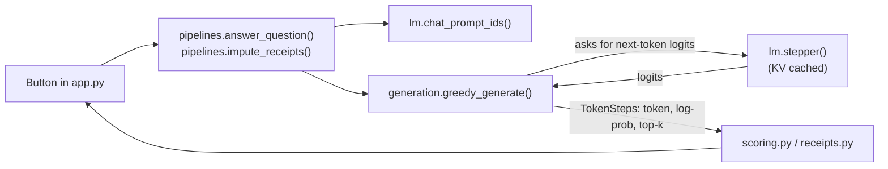

# Self-Check Explorer

An interactive Streamlit app for **seeing** how the Self-Check pattern works: a language model's own
token probabilities are used to spot answers, or parts of answers, that are likely to be wrong, so you
know what to trust and what to check. It runs a small open model (Qwen2.5) on your laptop, so you can
inspect the probability of every token instead of just reading about it.

It's a companion to the *Self-Check* examples in
[Generative AI Design Patterns](https://github.com/lakshmanok/generative-ai-design-patterns)
(`examples/31_self_check`) and covers both notebooks.

> **New to this?** Read [docs/how-self-check-works.md](docs/how-self-check-works.md) first. It
> explains every idea in plain language, with real numbers from this app.
> Terms are defined in [GLOSSARY.md](GLOSSARY.md).

---

## Quick start

Requirements: [uv](https://docs.astral.sh/uv/), about 2 GB of free RAM (about 4 GB to use the 1.5B
model), and an internet connection for the first run (to download the model).

```bash
uv sync                          # installs Python 3.12 + dependencies into .venv
uv run streamlit run app.py      # opens http://localhost:8501
```

The first click in any tab loads the model (around 5 to 20 seconds). After that, a question takes
roughly 3 to 25 seconds on a laptop CPU with the 0.5B model, depending on how long the answer is.

Run the tests (no model download needed; they use a fake model):

```bash
uv run pytest
```

Reproduce the numbers quoted in the guide:

```bash
uv run python scripts/capture_examples.py questions 0       # notebook 1's questions, 0.5B model
uv run python scripts/capture_examples.py steps 0 John      # every token of one question
uv run python scripts/capture_examples.py receipts 0        # notebook 2's rows
uv run python scripts/capture_examples.py receipts 0 20     # 20 random rows (seed 0)
```

### Configuration

| Setting | How | Default |
|---|---|---|
| Model | Sidebar (tabs ①②) and a dropdown in tab ③ | `Qwen/Qwen2.5-0.5B-Instruct` (also offers `1.5B`) |
| Device | `SCE_DEVICE=mps uv run streamlit run app.py` (or `cuda`) | `cpu` (or `cuda` if available) |
| Precision | `SCE_DTYPE=bfloat16 uv run streamlit run app.py` (or `float32`) | `float32` for 0.5B; `bfloat16` for 1.5B on CPU (half the memory) |

Only one model is held in memory at a time; switching models unloads the other. On an 8 GB Mac with
other apps open, the 1.5B model may push the system into swap and become very slow. The 0.5B model is
the comfortable choice there.

---

## How the app works

Three tabs, meant to be followed in order. Each one adds one idea on top of the last.

### ① Token confidence

**What it shows:** for every token of an answer, the probability the model gave it and the
alternatives it nearly chose. This is notebook 1's `analyze_logprobs` graph.

**You provide:** one of notebook 1's five questions (or your own), top-k (default 5), and a maximum
answer length.

**What happens when you click *Ask the model*** (`selfcheck_lab/generation.py`):

1. The question is wrapped in the notebook's system prompt ("You are a helpful AI assistant.") and
   Qwen's chat template.
2. The model generates greedily (temperature 0, always the top token). At every step the app takes
   the softmax of the logits, records the chosen token's **log-probability**, and records the top-k
   tokens. That's exactly what OpenAI returns with `logprobs=True, top_logprobs=5`.

**What you see:** the answer; the token tree (chosen tokens coloured by probability, alternatives in
grey); a table of every step; and a step slider with a bar chart of the top-k at that step. The
slider starts at the answer's least likely token.

### ② Response confidence score

**What it shows:** how token probabilities become one score per answer, and which tokens get
flagged. This is notebook 1's `calculate_response_confidence` and `analyze_token_confidence`.

**You provide:** several questions to compare, the weight `w` (default 0.7), the low-confidence
fraction (default 0.5), top-k, and a maximum length.

**What happens** (`selfcheck_lab/scoring.py`):

- `score = w × average + (1 − w) × minimum` of the token probabilities
- a token is **low-confidence** if its probability is below `fraction × average`

**What you see:** a side-by-side table (average, minimum, weakest token, score, number of low tokens),
then one expander per answer with a colour heatmap, the arithmetic written out with real numbers, and
the low-confidence tokens with their alternatives. The weight and fraction sliders re-score
instantly; only *Run* calls the model, and answers are cached.

### ③ Self-check on receipts

**What it shows:** the full pattern on data. The model fills in missing fields, each row gets a
**line confidence**, and a threshold decides which rows to trust and which to send for review. This
is notebook 2.

**You provide:** the notebook's 6 rows, or N random rows (seeded), editable in a table; a model; then
a review threshold and an error tolerance.

**What happens when you click *Fill in the missing values*** (`selfcheck_lab/receipts.py`):

1. All rows go to the model in **one** call with notebook 2's system prompt, plus one format line and
   one example (small models otherwise write prose).
2. The output tokens are grouped into lines exactly as the notebook does: a token containing a newline
   ends its line. Each line's confidence is its **lowest** token probability.
3. Output line *i* is paired with input row *i*, parsed, and compared with the **correct** row,
   computed exactly from the prompt's rules.

**What you see:**

1. Input and raw output side by side.
2. A heatmap of the output, with each line's weakest token underlined.
3. A table per row: line confidence, weakest token, gap from the correct value, whether it adds up,
   the notebook's verification error, any given value the model changed, and accept or review.
4. A scatter plot of line confidence against error, with the threshold drawn in.
5. A caught / missed / false alarm / trusted table for the current threshold.
6. Every token of one row.

---

## Project structure

```
app.py                      Streamlit UI (3 tabs). Only file that knows about Streamlit.
selfcheck_lab/
  lm.py                     Loads the model; chat prompts; KV-cached step function. Only file that touches torch models.
  generation.py             Greedy loop that records each token's log-probability and top-k alternatives.
  scoring.py                Response confidence score and low-confidence tokens (notebook 1).
  receipts.py               Receipt rows, correct answers, line splitting, line confidence, triage (notebook 2).
  tree.py                   The token tree as Graphviz DOT text.
  prompts.py                Questions and prompts from the notebooks.
  pipelines.py              One function per task: wires lm.py to the modules above.
scripts/capture_examples.py Prints the numbers quoted in the guide.
tests/                      Unit tests with a fake model (no download needed).
docs/
  how-self-check-works.md   Beginner's guide.
  adr/                      Architecture decision records.
GLOSSARY.md                 The project's vocabulary.
```

### How a click flows through the code



`generation.py`, `scoring.py` and `receipts.py` never import the model. They receive a function or
plain numbers, so the tests can use a tiny fake model and check the arithmetic exactly.

---

## Differences from the reference notebooks

See section 7 of the [guide](docs/how-self-check-works.md#7-where-the-app-differs-from-the-notebooks).
In short: a local Qwen model instead of OpenAI; one added format line in the receipt prompt;
verification against the exact correct answer as well as the notebook's formula; blank or chatty
output lines skipped instead of crashing; and the notebook's hard-coded numbers turned into sliders.
