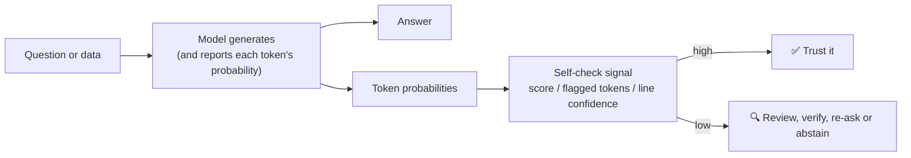
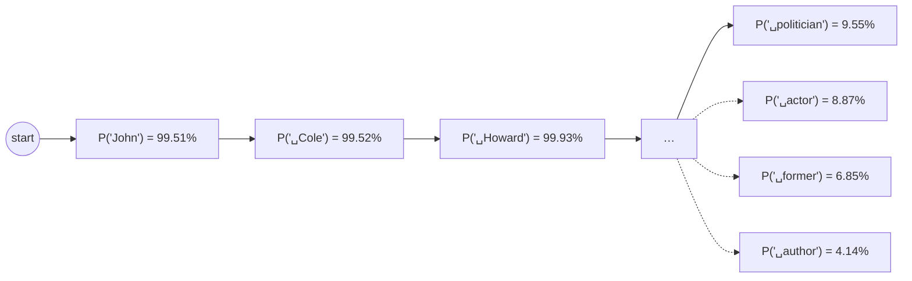
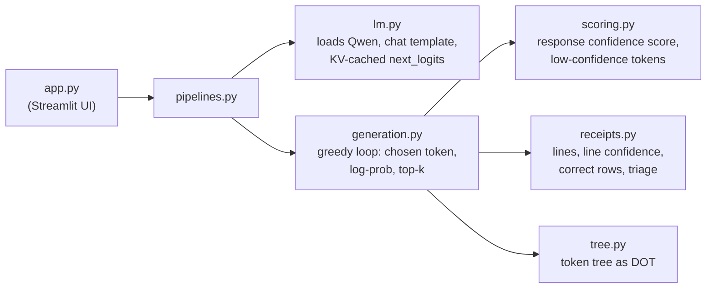

# How Self-Check Works: a Beginner's Guide

This guide explains the **Self-Check** pattern from the ground up, one idea at a time, using real
numbers produced by this app. You don't need to know anything about how language models work inside;
section 1 covers everything you need.

Every number in this guide comes from running the app's default model, **Qwen2.5-0.5B-Instruct**, with
greedy decoding (so you get the same numbers if you run the same thing). To reproduce them, see
`scripts/capture_examples.py`. Where it helps, the guide also quotes the numbers the original
notebooks got from OpenAI's GPT models.

**Contents**

1. [How a language model picks the next word, and where the probabilities come from](#1-how-a-language-model-picks-the-next-word)
2. [Token confidence (tab ①)](#2-token-confidence-tab-)
3. [Response confidence score (tab ②)](#3-response-confidence-score-tab-)
4. [Self-check on data: receipts (tab ③)](#4-self-check-on-data-receipts-tab-)
5. [What to do with a low score](#5-what-to-do-with-a-low-score)
6. [How the app is built](#6-how-the-app-is-built)
7. [Where the app differs from the notebooks](#7-where-the-app-differs-from-the-notebooks)
- [Appendix A: probabilities, logs and e, step by step](#appendix-a-probabilities-logs-and-e-step-by-step)
- [Appendix B: the response confidence score, by hand](#appendix-b-the-response-confidence-score-by-hand)
- [Appendix C: line confidence, by hand](#appendix-c-line-confidence-by-hand)
- [Appendix D: reading the review table](#appendix-d-reading-the-review-table)

---

## The idea in one paragraph

A language model writes one small piece of text (a **token**) at a time, and for each one it
calculates how likely every possible next token is. When it writes something it "knows" well, like
the year Atatürk was born, the chosen tokens usually have very high probability: there was no real
competition. When it is making something up, like a biography for a person who doesn't exist, the
probabilities are often spread over many options, and the token it picks may have only 10% or 20%. **Self-Check** reads those
probabilities after the answer is written and uses them as a warning light: *this part of the answer
was a guess, check it before you trust it.* It costs nothing extra (the probabilities are a
by-product of generating), and it needs no second model.



---

## 1. How a language model picks the next word

### Tokens

A model doesn't see words; it sees **tokens**, the pieces its tokenizer splits text into. Common
words are one token (`␣born`), rarer words are split (`Ataturk` → `At` + `atur` + `k`), and numbers
are written **one digit per token** in Qwen (`1881` → `1` + `8` + `8` + `1`). In the app, `␣` marks a
space at the start of a token and `⏎` marks a line break.

### Logits → probabilities

At every step the model produces one raw score, a **logit**, for each of the ~151,000 tokens in its
vocabulary. Logits can be any number (−3.2, 11.7, …). To turn them into probabilities, the model
applies the **softmax** function: raise *e* (≈ 2.718) to the power of each logit, then divide each
result by the total so they add up to 1.

A tiny made-up example with only three tokens:

| token | logit | e^logit | ÷ total (= probability) |
|---|---|---|---|
| `␣actor` | 2.0 | 7.39 | 7.39 / 11.12 = **0.665** |
| `␣politician` | 1.0 | 2.72 | 2.72 / 11.12 = **0.245** |
| `␣author` | 0.0 | 1.00 | 1.00 / 11.12 = **0.090** |
| | | total 11.12 | sum = 1.000 |

### Log-probability

APIs (and this app) usually report the **log-probability** instead of the probability: the natural
log of the probability. It's always ≤ 0. A log-probability of 0 means probability 1 (certain); −0.69
means 0.5; −2.3 means 0.1. To get the probability back, raise *e* to it:

> **token probability = e^(log-probability)**

That is exactly what the notebook does with `2.718281828459045 ** logprob`. Appendix A explains why
logs are used and has more conversions.

### Greedy decoding

The notebooks call the API with `temperature=0`, which means: **always pick the most likely token**.
This app does the same. So the chosen token is always the top of the list at each step, and its
probability tells you how far ahead of the rest it was:

- **99%**: no contest. Nearly all the probability sat on this one token.
- **50%**: the winner, but half the probability was spread over other options.
- **10%**: the winner by a hair. Many other tokens were nearly as likely, so the model had no strong
  preference.

That last case is the heart of Self-Check. **A low probability on the chosen token means the model
was choosing among many similar options**, and when the token is a fact (a name, a year, a number),
that usually means it didn't know.

### Top-k alternatives

Besides the chosen token, the API can return the **top-k** most likely tokens at each step (the
notebook uses k = 5). These are the "roads not taken". They're useful because they show *what kind*
of uncertainty it was: `␣politician` vs `␣actor` vs `␣author` (the model doesn't know who this is) is
very different from `␣compositions` vs `␣works` (two ways of saying the same thing).

---

## 2. Token confidence (tab ①)

### The idea

Generate an answer and look at the probability of **every token**, plus its alternatives. Nothing is
computed yet; this is just looking at the raw signal. Notebook 1 draws it as a tree:



Each solid box is the token the model chose; the dashed boxes branching from the **same parent** are
the alternatives it ranked next at that step. In the app, chosen boxes are coloured green (high) →
amber → red (low).

### A real example from the app: a person who doesn't exist

Question (notebook 1's): *"Who is John Cole Howard? Answer in one sentence."* There is no well-known
John Cole Howard. The 0.5B model answers:

> John Cole Howard is an American politician who served as the 10th Governor of New York from 2011 to 2017.

Every fact in that sentence is invented (the governor of New York from 2011 was Andrew Cuomo). Here
is every token and its probability, as the app shows it:

| step | token | probability | top alternatives the model didn't choose | what's happening |
|---|---|---|---|---|
| 0–2 | `John` `␣Cole` `␣Howard` | 99.5%, 99.5%, 99.9% | | just repeating the question: easy |
| 3 | `␣is` | 67.6% | | |
| 4 | `␣an` | 56.0% | | |
| 5 | `␣American` | 75.5% | | |
| **6** | **`␣politician`** | **9.6%** | `␣actor` 8.9%, `␣former` 6.9%, `␣author` 4.1% | **guessing a profession** |
| 7 | `␣who` | 49.4% | | |
| 8–10 | `␣served` `␣as` `␣the` | 92.5%, 93.6%, 79.6% | | grammar follows from "politician" |
| 11 | `␣` | 65.1% | | |
| **12** | **`1`** | **19.2%** | `2` 18.6%, `4` 13.9%, `3` 13.3% | **guessing a number** |
| **13** | **`0`** | **16.1%** | `1` 15.7%, `2` 12.3%, `4` 9.8% | |
| 14 | `th` | 73.3% | | |
| 15–16 | `␣Governor` `␣of` | 66.6%, 99.96% | | |
| **17** | **`␣New`** | **11.3%** | `␣Texas` 6.5%, `␣Pennsylvania` 6.2%, `␣North` 5.5% | **guessing a state** |
| 18 | `␣York` | 44.0% | | |
| 19–20 | `␣from` `␣` | 67.4%, 97.2% | | |
| 21–24 | `2` `0` `1` `1` | 80.7%, 100%, 49.7%, **23.0%** | | guessing a year |
| 25–30 | `␣to` `␣` `2` `0` `1` `7` | 99.1%, 99.96%, 100%, 100%, 97.2%, 39.4% | | |
| 31 | `.` | 87.6% | | |

Look at where the low numbers are. They aren't spread randomly: **they sit exactly on the invented
facts**: the profession (9.6%), the ordinal "10th" (19.2%, 16.1%), the state (11.3%), the years. At
step 6, `␣politician` beat `␣actor` by less than one percentage point. The model wasn't recalling a
fact; it was choosing among roughly equal guesses. Grammar tokens (`␣of` at 99.96%, `␣to` at 99.1%)
stay high even in a made-up sentence, because once you've written "Governor", the word "of" is
certain whether or not the governor exists.

### Compare: a fact the model knows

*"What year was Ataturk born? Answer in one sentence."* → **"Ataturk was born in 1881."** (correct)

| token | `At` | `atur` | `k` | `␣was` | `␣born` | `␣in` | `␣` | `1` | `8` | `8` | `1` | `.` |
|---|---|---|---|---|---|---|---|---|---|---|---|---|
| probability | 95.0% | 96.8% | 99.9% | 73.3% | 99.8% | 76.7% | 87.8% | 99.9% | 100% | 97.1% | 98.8% | 55.2% |

The year's four digits are 99.9%, 100%, 97.1%, 98.8%: no hesitation at all. The lowest token is
the final `.` at 55.2%, because the model was also considering continuing the sentence (e.g.
"… in 1881 in Salonica"). That's a *style* choice, not a fact, and it's a good first example of a
point we'll come back to: **not every low token is a problem.**

### What the notebook's GPT got

Notebook 1 asked GPT-3.5-turbo the same John Cole Howard question. GPT answered *"John Cole Howard is
a fictional character from the TV show 'The Office,' portrayed by actor Ed Helms."* Ed Helms played
Andy Bernard, not John Cole Howard, so this is a hallucination too. The notebook's tree showed `The`
at 36.81% and `␣Ed` at 36.68%, the two lowest tokens in the answer, again sitting right on the
made-up facts. A bigger model, the same signature.

### Try it

In tab ①, pick *John Cole Howard*, click **Ask the model**, and move the *Step* slider (it starts on
the least likely token). The bar chart shows how close the race was at that step. Then try *Ataturk*
and notice how short and green the tree is.

---

## 3. Response confidence score (tab ②)

### The idea

Looking at 32 probabilities is fine for a person, but a program needs **one number** to make a
decision ("show this answer" or "flag it"). Notebook 1 builds one:

> **response confidence score = 0.7 × average + 0.3 × minimum**
>
> where *average* and *minimum* are over the token probabilities of the whole answer.

Why mix the two?

- **The average alone hides problems.** An answer with 30 confident tokens and 2 wild guesses still
  averages high. The guesses get drowned out.
- **The minimum alone is too jumpy.** One unsure comma or full stop would sink an otherwise perfect
  answer (Atatürk's minimum is the `.` at 55%).
- **A weighted mix** mostly reflects the overall picture (70%) while still pulling the score down when
  there's one very weak spot (30%). In the app the weight is the slider **w**: w = 1 is the pure
  average, w = 0 the pure minimum.

The notebook also flags individual **low-confidence tokens**: any token whose probability is below
**half the answer's average**. The threshold is *relative*: an answer that's confident overall gets a
stricter bar than one that's shaky everywhere. In the app this is the second slider (0.5 by default).

### A worked example: Atatürk

From the 12 token probabilities above (full arithmetic in Appendix B):

- average = 10.8043 / 12 = **0.9004**
- minimum = **0.5521** (the `.`)
- score = 0.7 × 0.9004 + 0.3 × 0.5521 = 0.6303 + 0.1656 = **0.7959**
- low-confidence threshold = 0.5 × 0.9004 = **0.4502**. No token is below it, so **no tokens are
  flagged.**

### A real comparison from the app

All five of notebook 1's questions, 0.5B model, notebook settings (w = 0.7, fraction = 0.5):

| question | answer (shortened) | tokens | average | minimum | **score** | low tokens | was it right? |
|---|---|---|---|---|---|---|---|
| Atatürk's birth year | "Ataturk was born in 1881." | 12 | 0.900 | 0.552 | **0.796** | 0 | ✅ correct |
| Who is Clara Schumann? | "…German composer and pianist who lived from 1819 to 1876…" | 50 | 0.686 | 0.092 | **0.508** | 5 | ⚠️ mostly right, but she died in **1896**, not 1876 |
| Who is John Cole Howard? | "…American politician … 10th Governor of New York…" | 32 | 0.706 | 0.096 | **0.523** | 5 | ❌ invented |
| Marie Curie's lab conditions | "…10:00 AM and 25°C … 1000 hPa…" | 76 | 0.661 | 0.116 | **0.498** | 11 | ❌ invented (nobody recorded this) |
| Tesla & Edison joint patent | "Nikola Tesla and Thomas Edison collaborated on a joint patent…" | 150 | 0.665 | 0.110 | **0.498** | 19 | ❌ false premise accepted (there was no joint patent) |

What this table teaches:

1. **The one fully correct, well-known answer scores clearly highest** (0.80 vs about 0.50). This
   is the pattern working as intended.
2. **The flagged tokens are more useful than the score.** For John Cole Howard, the 5 flagged tokens
   are `␣politician`, `1`, `0` (of "10th"), `␣New`, and the last `1` of "2011", which are exactly
   the invented facts. For Marie Curie they include the digits of "10:00", the `5` of "25°C", and
   `␣Institute` (11.6%: she worked at the ESPCI in Paris, not an "Institute of Physical Chemistry in
   Warsaw").
3. **Uncertain ≠ wrong.** Clara Schumann's 5 flagged tokens are `␣compositions` (14.3%, vs
   `␣contributions` 11.5%, `␣piano` 9.5%, `␣works` 8.8%), `␣piano`, `␣and`, `␣contributions`,
   `␣Romantic`. All are **wording choices**, and the sentence is true either way. Meanwhile the one
   real error, the death year "1876" (she died in 1896), was **not** flagged. Its third digit `7`
   was chosen at 42.9%, ahead of `5` (33.8%) and the correct `9` (18.2%). So the model *was* unsure
   there, but 42.9% is above this answer's threshold (0.5 × 0.686 = 34.3%), so it slipped through.
   The threshold is a trade-off, and a wrong fact the model has absorbed firmly would look exactly
   like a right one. Self-check catches *guesses*, not *misconceptions*.
4. **Longer answers score lower.** More tokens means more chances for a wording choice to dip, so
   the minimum tends to fall as length grows. Compare scores between answers of similar length and
   format, or use the flagged tokens instead.
5. **The score doesn't separate "wrong" from "unknowable".** Marie Curie (unknowable) and Tesla &
   Edison (false premise) score the same as John Cole Howard. Self-check tells you *how sure* the
   model was, not *why* it wasn't.

### What the notebook's GPT got

| question | GPT-3.5 answer | score | lowest tokens |
|---|---|---|---|
| Atatürk | "Ataturk was born in 1881." | 82.98% | (none flagged) |
| Clara Schumann | correct one-sentence bio | 81.03% | (none flagged) |
| John Cole Howard | "…'The Office,' portrayed by actor Ed Helms." | **66.35%** | `The` 36.81%, `␣Ed` 36.68% |
| Marie Curie | *refused*: "I don't have access to…" | 70.18% | `␣don` 37.10%, `␣in` 41.24% |
| Tesla & Edison | *corrected the premise*: "they were rivals…" | 66.06%* | 14 wording tokens (`␣systems` 29.08%, …) |

GPT is a much bigger model: it got the facts right and refused or corrected the trick questions, and
its only hallucination (John Cole Howard) is the lowest score. The Marie Curie and Tesla rows show the
same lesson as point 3 above in reverse. (*The notebook's printout of this score was cut off; 66.06% is
0.7 × 81.91% + 0.3 × 29.08% from its printed average and minimum.) Those answers are *correct* refusals, but they still contain
low tokens, because there are many ways to phrase a refusal. The notebook's own comment: *"Hard to
make the models hallucinate on this one."*

### Try it

In tab ②, run the default three questions, then drag **w** from 0.7 to 1.0 and watch the
Clara Schumann score jump (the minimum stops counting) while Atatürk barely moves. Drag the
**threshold fraction** up to 0.8 and watch more and more wording tokens get flagged.

---

## 4. Self-check on data: receipts (tab ③)

### The task

Notebook 2 moves from questions to **data**. Each receipt row has four numbers:

```
billed_amount, tax, tip, paid_amount
```

Some fields are blank, and the model fills them in (**imputation**) using three rules from the
system prompt:

| if this is missing | compute it as |
|---|---|
| tax | 9.21% × billed_amount |
| tip | paid_amount − billed_amount − tax |
| paid_amount | billed_amount + tax + tip |

All rows go to the model in **one call** and it replies with one line per row. This is a realistic
use: cleaning up a spreadsheet, filling in a form, extracting fields from a document. The question
self-check answers is: **which of these rows can I trust without checking?**

### Line confidence

A whole answer gets a response confidence score; a **row** gets a **line confidence**:

> **line confidence = the lowest token probability among the tokens of that line**

The notebook uses the minimum (not the average) because in a row of numbers, *one* wrong digit makes
the whole row wrong, however confident the other 20 tokens were. The weakest token is the one that
matters.

How tokens are split into lines (exactly the notebook's loop): walk through the tokens in order; a
token whose text contains a line break **ends** the current line, and it counts toward the line it
ends. Appendix C does this by hand for one row.

### Knowing the right answer

Because the rules are plain arithmetic, the app can work out the **correct** row itself and compare.
For the notebook's six rows:

| row | input | what's missing | correct answer | arithmetic |
|---|---|---|---|---|
| 0 | `312.32,28.76,60,401.08` | nothing | `312.32,28.76,60,401.08` | copy it |
| 1 | `312.32,28.76,,400` | tip | `312.32,28.76,58.92,400` | 400 − 312.32 − 28.76 = 58.92 |
| 2 | `312.32,28.76,60,` | paid | `312.32,28.76,60,401.08` | 312.32 + 28.76 + 60 = 401.08 |
| 3 | `312.21,,50,` | tax, paid | `312.21,28.75,50,390.96` | tax = 312.21 × 0.0921 = 28.7545 → 28.75; paid = 312.21 + 28.75 + 50 = 390.96 |
| 4 | `312.43,,,400` | tax, tip | `312.43,28.77,58.8,400` | tax = 312.43 × 0.0921 = 28.7748 → 28.77; tip = 400 − 312.43 − 28.77 = 58.80 |
| 5 | `300,27.63,60,387.63` | nothing | `300,27.63,60,387.63` | copy it |

The app's **gap from correct** is the largest difference between the model's row and the correct
row, over all four fields. A row is **wrong** if the gap is more than the tolerance (1 cent by
default).

### Three ways to "verify" a row

The app shows three error columns. It's worth understanding why they differ:

1. **Gap from correct**: compared with the true answer. This is the real measure of wrongness, and
   it's only available because this is a teaching example where we can compute the truth.
2. **Adds up? error** = |billed + tax + tip − paid|, using the model's *own* numbers. It checks
   internal consistency. A row can add up perfectly and still be wrong, e.g. if the model changed
   a value it was given so that its wrong answer balances.
3. **Notebook's error** = |round(billed × 1.0921, 2) + tip − paid|. This is the notebook's
   `verify_row`. It **ignores the tax column** and assumes tax is always exactly 9.21%. It's close to
   #2 when the tax is right, but it can't see a wrong tax, and it would flag a row whose given tax
   isn't 9.21%.

The notebook's GPT run shows why this matters. For row 4, GPT-4o-mini wrote
`312.43, 28.80, 60, 401.23`. The notebook's error says **0.03**: nearly perfect. But the paid amount
was *given* as 400, and GPT changed it to 401.23 so its tip of 60 would add up. Against the true
answer (`312.43, 28.77, 58.80, 400`) the gap is **$1.23**. Internal consistency is not correctness.

### A real example from the app: the notebook's rows (0.5B)

The model replied:

```
312.32,28.76,60,401.08
312.32,28.76,400,387.63
312.32,28.76,60,387.63
312.21,50,50,400
312.43,0,400,387.63
```

It produced only five lines (row 5 got no output) and made a mess of the arithmetic, as a 0.5B
model does. What matters here is whether line confidence *notices*:

| row | model's line | correct | gap | line confidence | weakest token |
|---|---|---|---|---|---|
| 0 | `312.32,28.76,60,401.08` | same | **$0.00** ✔️ | **0.688** | first `3` (alt `1` 22%) |
| 1 | `312.32,28.76,400,387.63` | `…,58.92,400` | $341.08 ❌ | 0.463 | `3` of 387.63 (alt `1` 25%) |
| 2 | `312.32,28.76,60,387.63` | `…,60,401.08` | $13.45 ❌ | 0.667 | `3` of 387.63 (alt `4` 33%) |
| 3 | `312.21,50,50,400` | `…,28.75,50,390.96` | $21.25 ❌ | 0.463 | `5` of the tax (alt `6` 34%) |
| 4 | `312.43,0,400,387.63` | `…,28.77,58.8,400` | $341.20 ❌ | 0.401 | the `,` after `0` (alt `.` 32%) |
| 5 | (no output) | `300,27.63,60,387.63` | ❌ | — | — |

Read the weakest tokens. In row 2, the paid amount should be `401.08`, and at its first digit the
model chose `3` (66.7%) while `4`, the right start, had 32.6%. The model *nearly* wrote the right
number. In row 4, it hesitated between `0,` and `0.` (i.e. "0" vs "0.something"). The low token
sits right where the model invented a number, just as in tab ②.

Row 0 is right, yet its weakest token is still only 68.8%: its very first token `3`. That's not about the number at all; it's the model deciding *how to start its reply*
(`3` vs `1`, possibly a "1." list). The first token of a reply often carries that kind of
format uncertainty.

### Turning line confidence into a decision

A **review threshold** turns the number into an action: rows below it go to a person (or a
calculator, or a bigger model); rows above it are accepted automatically. Rows that couldn't be read
at all always go to review. Here's the same run at four thresholds:

| threshold | caught (wrong, reviewed) | missed (wrong, accepted) | false alarm (right, reviewed) | trusted (right, accepted) |
|---|---|---|---|---|
| 0.3 | row 5 | rows 1, 2, 3, 4 | — | row 0 |
| 0.5 | rows 1, 3, 4, 5 | **row 2** (0.667) | — | row 0 |
| **0.68** | rows 1, 2, 3, 4, 5 | — | — | row 0 |
| 0.7 | rows 1–5 | — | row 0 (0.688) | — |

Too low and wrong rows slip through (missed); too high and right rows waste a reviewer's time (false
alarms). Here only a threshold between 0.667 and 0.688 is perfect: a very narrow window. In real data there's rarely a
perfect threshold; Appendix D explains how to choose.

### A realistic example: 12 random receipts (seed 1)

In tab ③, choose **Random rows**, 12 rows, seed 1 (the defaults). Six rows are complete (just copy
them); six have one blank. The model's reply:

```
188.05,17.32,37.61,242.98            ← it skipped row 0 entirely
25.91,2.39,32.96,322.65
292.79,43.92,363.68,396.60
23.59,2.17,30.48,364.01
279.3,25.72,355.29,422.00
376.58,34.68,20,431.26
99.23,9.14,17.86,126.23
367.76,33.87,73.55,1000.00
346.08,31.87,60,1000.00
207.81,19.14,37.41,264.36
241.22,,70,333.44,1000.00
```

Sorted by line confidence:

| row | needed | model's line | gap | line confidence | weakest token |
|---|---|---|---|---|---|
| 0 | nothing | (skipped) | ❌ | — | — |
| 5 | tip | `279.3,25.72,355.29,422.00` | $305.02 ❌ | 0.142 | `2` (alts `0` 13%, `8` 10%) |
| 8 | paid | `367.76,33.87,73.55,1000.00` | $524.82 ❌ | 0.150 | `0` of 1000 (alts `1` 11%, `6` 11%) |
| 2 | tip | `25.91,2.39,32.96,322.65` | $289.69 ❌ | 0.187 | `6` (alts `9` 17%, `3` 15%) |
| 4 | tip | `23.59,2.17,30.48,364.01` | $333.53 ❌ | 0.221 | `6` (alts `3` 17%, `7` 13%) |
| 1 | nothing | `188.05,17.32,37.61,242.98` | $0.00 ✔️ | 0.279 | `8`, its 2nd token (alt `0` 11%) |
| 11 | tax | `241.22,,70,333.44,1000.00` | unparseable ❌ | 0.391 | `1` |
| 9 | paid | `346.08,31.87,60,1000.00` | $562.05 ❌ | 0.406 | `0` of 1000 (alt `6` 22%) |
| 3 | tax | `292.79,43.92,363.68,396.60` | $319.76 ❌ | 0.453 | `0` (alt `1` 28%, `⏎` 24%) |
| 10 | nothing | `207.81,19.14,37.41,264.36` | $0.00 ✔️ | 0.680 | the `⏎` (alt *end of text* 32%) |
| 6 | nothing | `376.58,34.68,20,431.26` | $0.00 ✔️ | 0.810 | `3` |
| 7 | nothing | `99.23,9.14,17.86,126.23` | $0.00 ✔️ | 0.979 | `2` |

With the threshold at **0.5**: caught **8 of 8** wrong rows, missed none, one false alarm (row 1),
and 3 rows trusted. A reviewer checks 9 of 12 rows instead of all 12, and nothing wrong gets through.
On the scatter plot the red dots (wrong) all sit low, and three of the four green dots (right) sit
high.

The two "right but low" rows are worth understanding, because they show what *else* line confidence
picks up besides wrong arithmetic:

- **Row 1 (0.279)**: the model skipped row 0 and started its reply with row 1. Its second token `8`
  (of 188.05) was a toss-up, because the model was choosing *which row to write first*, not doing
  arithmetic. The number it wrote is right; the doubt was about the reply's structure.
- **Row 10 (0.680)**: every digit is near-certain, but the line's **line break** is only 68%: with
  32% the model wanted to stop here (*end of text*). Because the notebook counts the newline token
  toward the line it ends, "should I stop?" doubt lowers this row's line confidence.

Other details: row 3 changed *two* given values (tip and paid), which the *changed a given value*
column catches directly, an easy extra check worth having in real systems. Row 11 has five numbers,
so it can't be read: unparseable rows always go to review. The model also writes `1000.00` for
every missing paid amount it can't work out, a made-up placeholder, and each of those rows has a low
`0` token.

### Where self-check fails: 10 random receipts (seed 0)

Choose 10 rows, seed 0. The model falls into a pattern from the very first line: *fill the blank by
repeating the last number*. (12 rows with seed 0 does the same.)

```
340.1,31.32,376.42,376.42          ← should be 340.1,31.32,5,376.42
170.9,40,226.64,226.64
209.3,19.28,266.25,266.25
395.09,36.39,79.02,79.02
295.99,27.26,353.25,353.25
…
```

All 10 rows are wrong, but after the first two (0.27 and 0.52) the line confidences are **0.92 to
0.999**. Once a
pattern is established, following it is easy for the model, so it is *confident*. At a threshold of
0.7 the review table says: caught 2, **missed 8**.

This is the most important limit of the pattern: **self-check measures how sure the model is, and a
model can be sure and wrong**. Repeated or systematic errors, a misunderstood instruction, a fact it
learned wrong: none of them show up as low probability. That's why the pattern is usually paired with
cheap independent checks (does the row add up? did it change a given value? does it have the right
number of fields?) rather than used alone. In this run the *adds up?* error column flags every single
row.

### What the notebook's GPT got

GPT-4o-mini on the notebook's six rows (the notebook's own output, with the gap computed by this
app's rules):

| row | GPT's line | line confidence | notebook's error | gap from correct |
|---|---|---|---|---|
| 0 | `312.32, 28.76, 60, 401.08` | **0.963** | 0.00 | $0.00 ✔️ |
| 1 | `312.32, 28.76, 60, 400.00` | 0.552 | 1.08 | $1.08 ❌ (tip should be 58.92) |
| 2 | `312.32, 28.76, 60, 400.08` | 0.562 | 1.00 | $1.00 ❌ (paid should be 401.08) |
| 3 | `312.21, 28.84, 50, 391.05` | **0.173** | 0.09 | $0.09 ❌ (tax should be 28.75) |
| 4 | `312.43, 28.80, 60, 401.23` | **0.170** | 0.03 | $1.23 ❌ (changed the given paid) |
| 5 | `300, 27.63, 60, 387.63` | **0.999** | 0.00 | $0.00 ✔️ |

Same story with a far bigger model: the two complete rows sit at 0.96 and 0.999, and every imputed
row is at 0.56 or below. A threshold anywhere between 0.57 and 0.96 sorts them perfectly. The
notebook's scatter plot (`error` vs `confidence`) shows exactly this.

### Try it

1. Notebook's rows, click **Fill in the missing values**, then drag the threshold from 0.3 to 0.9 and
   watch rows move between *missed*, *caught* and *false alarm*.
2. Random rows, 12, seed 1: find the threshold that catches every wrong row with the fewest false
   alarms.
3. Random rows, 10, seed 0: see the confident failure, and notice the *adds up?* column catching
   what line confidence missed.
4. Switch the horizontal axis to *notebook's error* and find a row where it disagrees with the gap.

---

## 5. What to do with a low score

Self-check produces a signal; the pattern is completed by what you **do** with it. Common choices,
cheapest first:

| action | example |
|---|---|
| **Show a warning** | Highlight low-confidence tokens or rows in the UI, like the app's heatmap. The user decides. |
| **Verify with a tool** | Recompute a row with a calculator, look a name up in a database, run the code. |
| **Ask again, differently** | Re-ask the question with more context (retrieval), or ask a bigger model only for the flagged items. |
| **Send to a person** | Put flagged rows in a review queue (the app's *🔍 review*). |
| **Abstain** | Reply "I'm not sure" instead of showing the answer. |

Because the probabilities come free with generation, a common design is: **accept the confident
majority automatically, and spend expensive checking only on the uncertain few.** In the 12-row
example, a reviewer looks at 9 rows instead of 12 and misses nothing.

Things to keep in mind:

- **Thresholds are model-specific and task-specific.** GPT's right rows were at 0.96+; Qwen's
  right notebook row was at 0.69. Calibrate on examples where you know the answer, as tab ③ does.
- **Uncertain ≠ wrong, and confident ≠ right** (sections 3 and 4).
- **You need log-probabilities from the API.** OpenAI returns them with `logprobs=True`; local models
  always have them. Some APIs don't expose them at all, and then this pattern isn't available.
- **Sampling changes things.** With temperature > 0 the chosen token isn't always the most likely
  one, so a low probability can mean "the sampler picked an unlikely token", not "the model was
  unsure". The notebooks and the app use temperature 0.

---

## 6. How the app is built



- **`lm.py`** is the only file that touches the real model. It formats the chat prompt and returns a
  `next_logits(prev_token)` function that keeps the model's KV cache between steps (so each step
  only processes one new token).
- **`generation.py`** runs greedy decoding: at each step it applies `log_softmax` to the logits,
  takes the top-k, and records a `TokenStep` (token text, log-probability, alternatives). This is
  exactly the data OpenAI returns as `logprobs.content`. It decodes the whole prefix each step so a
  character split across two tokens (like the `ü` in "Atatürk") is attributed correctly.
- **`scoring.py`** and **`receipts.py`** contain only arithmetic on those steps. They never import
  the model, so `tests/` checks them with a tiny fake model and exact numbers.
- **`app.py`** is the only file that knows about Streamlit.

---

## 7. Where the app differs from the notebooks

| # | notebook | app | why |
|---|---|---|---|
| 1 | OpenAI GPT-3.5-turbo / GPT-4o-mini | local Qwen2.5-0.5B (1.5B optional) | free, offline, every probability visible; small models hallucinate readily, which makes the pattern easy to see (see `docs/adr/0001`) |
| 2 | top-5 from the API | top-k from the full distribution (slider, default 5) | we compute softmax ourselves |
| 3 | `graphviz` Python package + system binary | the same DOT graph drawn in the browser | no system install |
| 4 | weight 0.7 and "50% of average" hard-coded | sliders (defaults 0.7 and 0.5) | to see what they do |
| 5 | receipt prompt says only "Do not add any headers or explanations" | adds a format instruction and a two-line worked example | small models otherwise reply in prose or merge all rows into one line |
| 6 | `pd.read_csv` on the reply (crashes on bad output) | each line parsed separately; bad lines become *unparseable*; lines with no digits are skipped | small models produce messy output; the app should show it, not crash |
| 7 | output line *i* = input row *i* | each input row is matched to the next output line starting with its billed amount | a skipped or merged line would otherwise misalign every row after it |
| 8 | `verify_row` only (hard-coded 9.21%, ignores the tax column) | also *gap from correct* and *adds up?* | see "Three ways to verify a row" |
| 9 | six fixed rows | the same six, plus seeded random rows (about half complete) and an editable table | more points on the scatter plot; complete rows give a "right" group to compare against |
| 10 | one decision left implicit | review threshold and caught/missed table | the point of the pattern is to act on the signal |
| 11 | (OpenAI's servers) | 0.5B in float32; 1.5B in bfloat16 on CPU (`SCE_DTYPE` to change) | bfloat16 halves memory so 1.5B fits on an 8 GB laptop, but it rounds probabilities coarsely, so the default model stays in float32 |

Kept the same on purpose: greedy decoding (temperature 0), the questions, the system prompts (apart
from #5), the formula `0.7 × avg + 0.3 × min`, the relative low-confidence threshold, line
confidence as the minimum, and the newline token counting toward the line it ends.

---

## Appendix A: probabilities, logs and e, step by step

**Why logs?** A sentence's probability is the *product* of its tokens' probabilities, and multiplying
many numbers below 1 quickly gives numbers too small for a computer (0.5 multiplied 1,000 times is
about 10⁻³⁰¹). Logs turn products into sums (log(a × b) = log a + log b), which stay manageable. So
models and APIs work in log-probabilities.

**Converting.** probability = e^(log-probability); log-probability = ln(probability).

| log-probability | probability | meaning |
|---|---|---|
| 0 | 1.000 (100%) | certain |
| −0.0006 | 0.9994 | the `k` in "Ataturk" |
| −0.105 | 0.900 | very confident |
| −0.310 | 0.733 | `␣was` in "Ataturk was born" |
| −0.594 | 0.552 | the final `.` in "…born in 1881." |
| −0.693 | 0.500 | coin flip between two options |
| −2.349 | 0.0955 | `␣politician` for John Cole Howard |
| −4.605 | 0.010 | 1 in 100 |

To compute e^x by hand-calculator: e^(−0.594) = 1 / e^(0.594) = 1 / 1.811 = 0.552.

**Where the top-k sum goes.** At a confident step the top 5 tokens hold nearly 100% of the
probability. At an unsure step they might hold only 60%; the other 40% is spread across thousands of
tokens, each tiny. Tab ①'s step view prints this sum.

---

## Appendix B: the response confidence score, by hand

Atatürk, 0.5B model, 12 tokens:

| # | token | log-probability | probability = e^lp |
|---|---|---|---|
| 1 | `At` | −0.0510 | 0.9503 |
| 2 | `atur` | −0.0327 | 0.9678 |
| 3 | `k` | −0.0006 | 0.9994 |
| 4 | `␣was` | −0.3101 | 0.7334 |
| 5 | `␣born` | −0.0016 | 0.9984 |
| 6 | `␣in` | −0.2647 | 0.7674 |
| 7 | `␣` | −0.1307 | 0.8775 |
| 8 | `1` | −0.0008 | 0.9992 |
| 9 | `8` | 0.0000 | 1.0000 |
| 10 | `8` | −0.0297 | 0.9707 |
| 11 | `1` | −0.0120 | 0.9881 |
| 12 | `.` | −0.5940 | 0.5521 |
| | | **sum** | **10.8043** |

1. **Average** = 10.8043 / 12 = **0.9004**
2. **Minimum** = **0.5521** (token 12)
3. **Score** = 0.7 × 0.9004 + 0.3 × 0.5521 = 0.63028 + 0.16563 = **0.7959** (79.59%)
4. **Low-confidence threshold** = 0.5 × 0.9004 = 0.4502. Is any probability below 0.4502? The
   smallest is 0.5521, so **no**.

Now John Cole Howard (32 tokens, from the table in section 2): the probabilities sum to 22.5941, so
average = 22.5941 / 32 = **0.7061**; minimum = **0.0955** (`␣politician`);
score = 0.7 × 0.7061 + 0.3 × 0.0955 = 0.4943 + 0.0287 = **0.5229**; threshold = 0.5 × 0.7061 =
0.3530, and five tokens are below it: `␣politician` 0.0955, `1` 0.1918, `0` 0.1612, `␣New` 0.1125,
`1` 0.2297.

Notice how the two parts contribute. The averages differ by 0.19 (0.90 vs 0.71), contributing
0.7 × 0.19 = 0.14 to the gap; the minimums differ by 0.46 (0.55 vs 0.10), contributing
0.3 × 0.46 = 0.14. The minimum, despite its smaller weight, matters as much as the average here.

---

## Appendix C: line confidence, by hand

Row 2 of the notebook's rows, 0.5B model. The model wrote `312.32,28.76,60,387.63` followed by a line
break. Its 23 tokens (Qwen writes each digit as its own token):

| token | `3` | `1` | `2` | `.` | `3` | `2` | `,` | `2` | `8` | `.` | `7` | `6` |
|---|---|---|---|---|---|---|---|---|---|---|---|---|
| p | 0.997 | 0.982 | 1.000 | 1.000 | 0.799 | 0.997 | 0.996 | 0.986 | 0.981 | 1.000 | 1.000 | 1.000 |

| token | `,` | `6` | `0` | `,` | **`3`** | `8` | `7` | `.` | `6` | `3` | `⏎` |
|---|---|---|---|---|---|---|---|---|---|---|---|
| p | 0.818 | 0.966 | 1.000 | 0.927 | **0.667** | 0.999 | 0.999 | 1.000 | 1.000 | 1.000 | 0.982 |

Walking through the notebook's loop:

1. Start the line with `confidence_of_line = 1.0`.
2. For each token, `confidence_of_line = min(confidence_of_line, p)`:
   1.0 → 0.997 → 0.982 → … → 0.799 (the `3` of `.32`) → … → **0.667** (the `3` of `387.63`) → stays
   0.667 to the end.
3. The `⏎` token (0.982) contains a line break, so it is the last token of this line; the next token
   starts row 3 with `confidence_of_line = 1.0` again.

**Line confidence = 0.667.** The weakest token is the first digit of the paid amount, where the model
chose `3` over `4` (32.6%). The correct paid amount was `401.08`, so that `4` was the right
start. The line's one uncertain moment is exactly where it went wrong.

---

## Appendix D: reading the review table

Every row ends up in one of four boxes:

| | 🔍 sent to review | ✅ auto-accepted |
|---|---|---|
| **❌ actually wrong** | **caught**: good, the check paid off | **missed**: bad, a wrong value got through |
| **✔️ actually right** | **false alarm**: harmless but wastes a reviewer's time | **trusted**: good, no effort spent |

Raising the threshold moves rows from the right column to the left: fewer misses, more false
alarms. Lowering it does the opposite. Two numbers summarise a threshold:

- **Catch rate** = caught / (caught + missed): what share of the wrong rows you'd find. In the
  notebook-rows example at 0.5: 4 / (4 + 1) = 80%. At 0.68: 5 / 5 = 100%.
- **Review load** = (caught + false alarms) / all rows: how much you'd have to check. At 0.68: 5 / 6.
  At 0.5 in the 12-row example: 9 / 12, with a 100% catch rate.

How to pick a threshold in practice:

1. Collect examples where you know the right answer (like tab ③ does automatically).
2. Decide which mistake is worse. For money, a missed error is usually much worse than a false alarm,
   so lean high.
3. Choose the lowest threshold that gives an acceptable catch rate, and check the review load is
   affordable.
4. Re-check whenever you change the model or the prompt: thresholds don't carry over (Qwen's right
   notebook row was at 0.69; GPT's were at 0.96 and 0.999).
